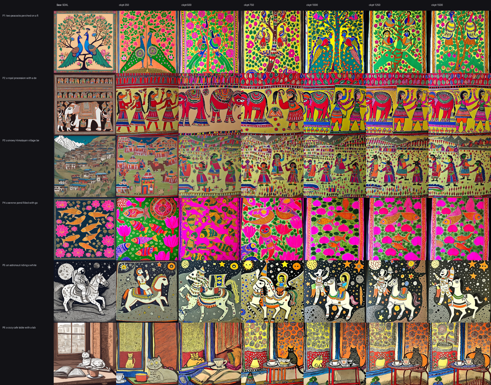

# sdxl-lora-studio

Training a **SDXL LoRA** for a custom subject/style from 15–40 images on a **free Kaggle T4**,
with a reproducible checkpoint-comparison grid, CLIP/DINO metrics, and a Gradio demo.

> Status: ✅ Trained & Evaluated — see [PLAN.md](PLAN.md) for roadmap and [NOTES.md](NOTES.md) for technical decision log.

## Results

### Checkpoint × Prompt Comparison Grid

Fixed evaluation grid rendering across 6 diverse prompts (traditional motifs, regional scenes, out-of-distribution prompts) comparing **Base SDXL (0)** against trained checkpoints (`ckpt-250` through `ckpt-1500`):



### Quantitative Evaluation (CLIP Content Adherence + DINOv2 Style Similarity)

To quantitatively select the best checkpoint and prevent overfitting:
- **CLIP Content Score (`openai/clip-vit-large-patch14`)**: Measures prompt adherence on the generated images with the style trigger prefix stripped.
- **DINOv2 Style Similarity (`facebook/dinov2-base`)**: Measures feature cosine similarity to the reference Mithila training dataset.
- **DINOv2 Max-NN**: Tracks nearest-neighbor memorization (threshold: `< 0.88`).

| Checkpoint | CLIP Content Score ↑ | DINOv2 Style Sim ↑ | DINOv2 Max-NN (Memorization) | Status |
|---|---:|---:|---:|---|
| Base SDXL (0) | 0.2961 | 0.1865 | 0.3956 | Baseline |
| `ckpt-250` | 0.2718 | 0.3728 | 0.5945 | Underfit / warming up |
| `ckpt-500` | 0.2501 | 0.3544 | 0.5937 | Good |
| **`ckpt-750`** | **0.2666** | **0.3949** | **0.6317** | ⭐ **Selected Best** |
| `ckpt-1000` | 0.2588 | 0.3694 | 0.6043 | Good |
| `ckpt-1250` | 0.2568 | 0.3957 | 0.6263 | Good |
| `ckpt-1500` | 0.2641 | 0.3814 | 0.6214 | Late-stage saturation |

#### Checkpoint Selection Rationale
- **Baseline (Base SDXL):** Weak Mithila style prior (DINO style similarity `0.1865`).
- **`ckpt-750` (Winner):** Delivers a **+111% style similarity gain** (`0.3949`) while maintaining the highest prompt content fidelity (`0.2666`) among all trained checkpoints. Max nearest-neighbor score is `0.6317`, confirming authentic artistic generalization without memorizing specific training canvases.
- **Later Checkpoints (`1000–1500`):** Begin showing background motif repetition and over-saturation across prompts.

## Layout

```
src/lora_studio/   prepare (crop/resize/dedupe), caption, grid, metrics
scripts/           train_sdxl_lora.sh (diffusers DreamBooth-LoRA)
configs/           training hyper-params
prompts/           fixed eval prompts (same prompts + seeds for every checkpoint)
kaggle/train/      Kaggle kernel (T4)
space/             Gradio demo for HF Spaces
data/              raw + processed images (git-ignored)
tests/
```

## Quickstart

```bash
uv venv && source .venv/bin/activate
uv pip install -e ".[dev]"
python -m lora_studio.prepare data/raw data/processed
kaggle datasets create -p data/processed
kaggle kernels push -p kaggle/train
```

## License

MIT (code). Base model under the CreativeML Open RAIL++-M license.
